# Nearly

**Games of almost.** Small games about the gap between what you perceived and what you can make again: a colour shows for three seconds, a tone plays twice, a beat runs for two bars; then it is gone and you recreate it from memory. The score says how close you got.

Each game is a Zurich-style concert poster: flat inks, one heavy grotesk, circles as the only figures. It installs like an app, **works fully offline**, needs no account and sends nothing anywhere.

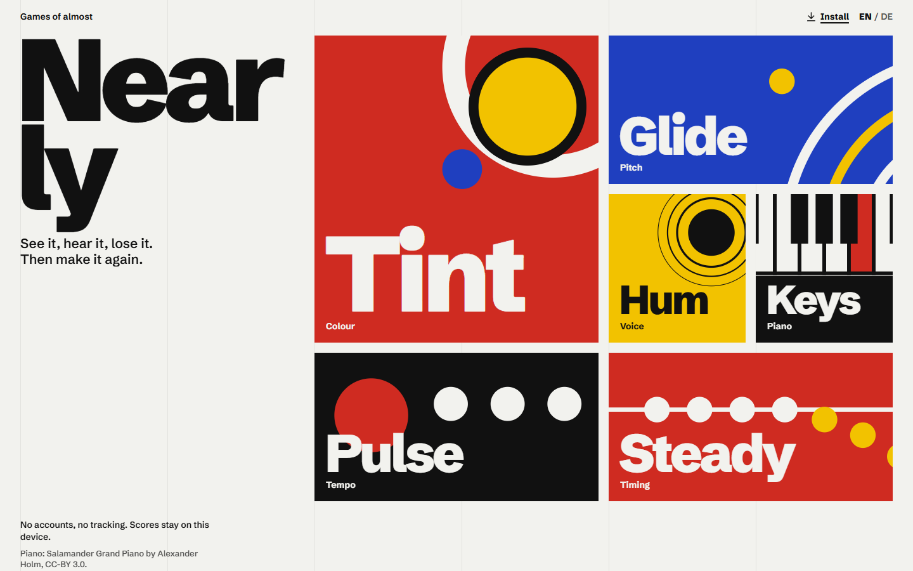

## The games

| Game | Kind | You get | You make it with | Scored by |
|---|---|---|---|---|
| **Tint** | Colour | a colour, 3 seconds | three rings: hue, saturation, brightness (strips on phones) | colour difference in OKLab (5 points at ΔE 10) |
| **Glide** | Pitch | a tone, twice | a ring that tunes your own tone | cents (5 points at 75 cents) |
| **Hum** | Voice | a tone, twice | your voice, any octave (microphone) | cents, octave folded (5 points at 75 cents) |
| **Keys** | Piano | a recorded piano note, twice | a keyboard, C3 to B5 (three stacked octaves on phones) | semitones (5 points at 1.5) |
| **Pulse** | Tempo | a beat, two bars | a ring that sets your own beat | percent (5 points at 6 %) |
| **Steady** | Timing | a beat, two bars, then silence | your taps for the next two bars | average miss per beat (5 points at 45 ms), with the drift note by note |

Every game is five rounds of up to 10 points: 10 for exact, 5 at the game's half-way error, about 1 at three times that. The result rings show the same thing as a picture: the target is the centre, every ring is two points less, and each answer lands in the direction of its miss (higher/sharper/faster up). Best totals stay on the device.

## How it plays

Every game runs the same way: the target, then your attempt, then the reveal. Each answer lands on the result rings at its real distance from the target.

<table>
  <tr>
    <td width="33%" align="center">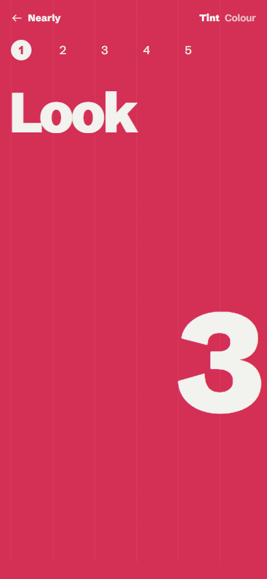</td>
    <td width="33%" align="center">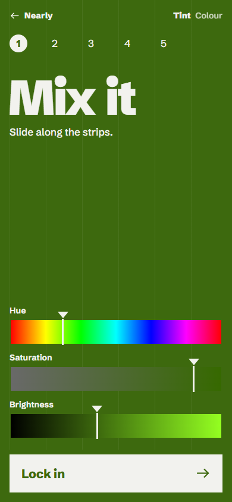</td>
    <td width="33%" align="center">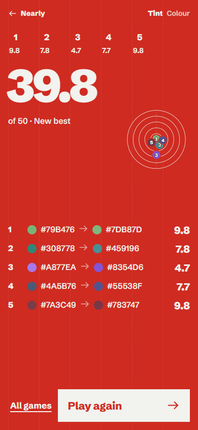</td>
  </tr>
  <tr>
    <td><b>Look.</b> Tint shows a colour for three seconds, edge to edge.</td>
    <td><b>Mix it.</b> On a phone, three strips; on a desktop, three concentric rings you turn.</td>
    <td><b>Five rounds.</b> Each answer sits on the rings at its colour difference from the target.</td>
  </tr>
  <tr>
    <td align="center">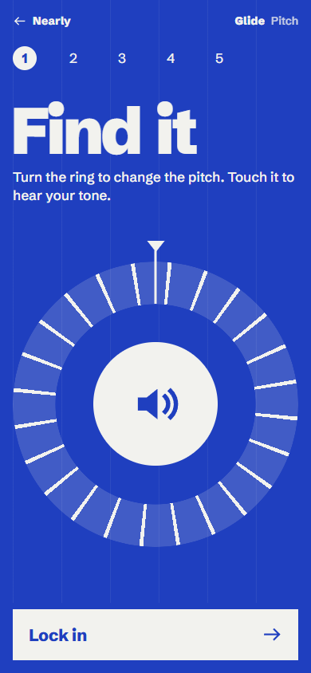</td>
    <td align="center">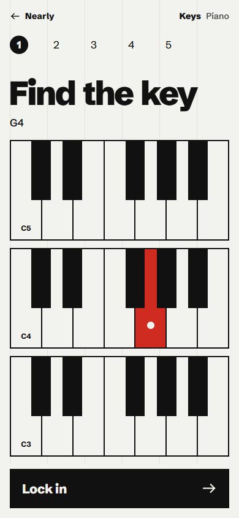</td>
    <td align="center">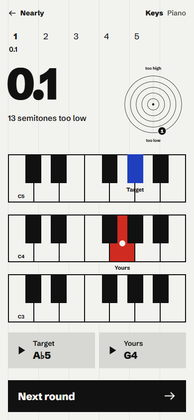</td>
  </tr>
  <tr>
    <td><b>Glide.</b> Turn the ring until your tone is the one you heard.</td>
    <td><b>Keys.</b> A recorded grand piano, three octaves; try keys as often as you like.</td>
    <td><b>The reveal</b> shows your key against the target's, and plays both again.</td>
  </tr>
  <tr>
    <td align="center">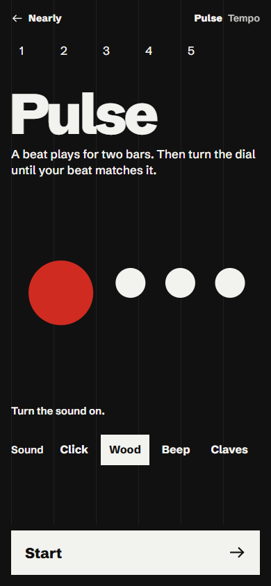</td>
    <td align="center">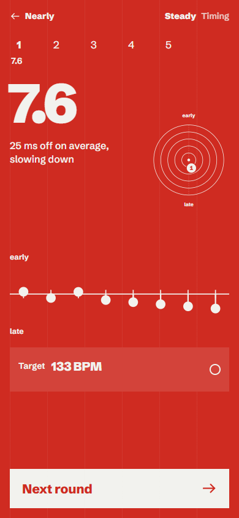</td>
    <td align="center">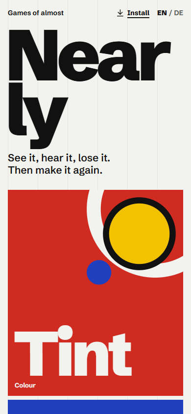</td>
  </tr>
  <tr>
    <td><b>Pulse</b> and <b>Steady</b> let you pick the metronome sound.</td>
    <td><b>Steady</b> charts every tap: early above the line, late below, so drifting shows at a glance.</td>
    <td><b>The hub</b> on a phone: one poster per game.</td>
  </tr>
</table>

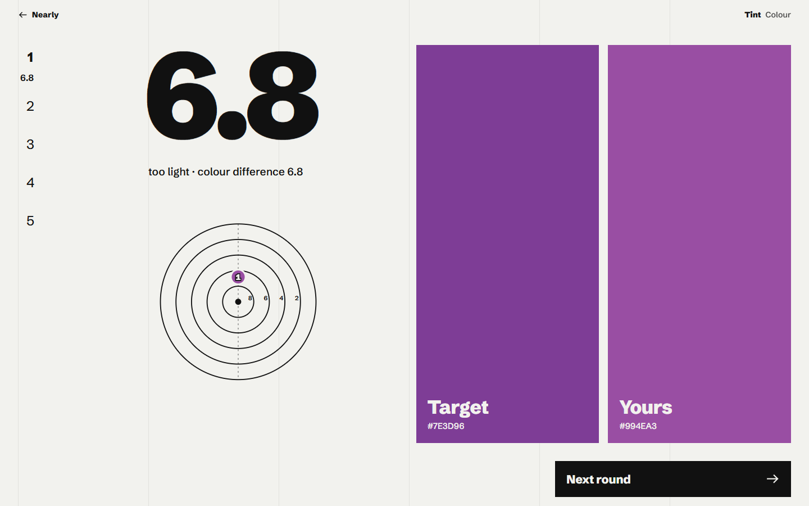

<sub>Screenshots of the real app, captured in a test browser (the answers were entered by a script).</sub>

Pulse and Steady let you pick the click: the four metronome sounds from Tactus (click, wood, beep, claves).

English and German, following the device language (switch at the top of the hub). German note names in the music games (H, Cis, Es).

## Develop

```sh
npm install          # vite, typescript and the bundled font: 27 packages in total
npm run dev          # http://localhost:5173
npm run build        # typecheck + build into dist/
npm run build:wasm   # rebuild the Rust pitch detector (needs: rustup target add wasm32-unknown-unknown)
npm run icons        # redraw the app icons (plain Node, no dependencies)
```

No UI framework: `src/core/dom.ts` has a ten-line `h()` element helper, and that is all the app needs.

```
src/
  main.ts              router (#<game>), install and update plates, service worker
  core/
    game.ts            the Game / Round contract every game implements
    session.ts         the game screen: intro, 5 × (show, make, reveal), summary
    hub.ts             the poster wall
    score.ts color.ts  one points curve for all games; HSB, OKLab, ΔE
    i18n.ts store.ts   strings (EN/DE); best scores and language in localStorage
  ui/
    dial.ts            the concentric ring dial (pointer, wheel, keyboard)
    strips.ts          its compact sibling for narrow screens (Tint on phones)
    rings.ts           the result rings
  audio/
    synth.ts           tones and the Tactus metronome clicks (synthesised), the recorded piano
    piano/             Salamander Grand Piano samples (CC-BY 3.0)
    listen.ts          microphone pitch for Hum
    pitch.worklet.ts band.ts mpm.ts pitch.wasm   from Tactus (../music-tools)
  games/               tint, glide, hum, keys, pulse, steady, beat (scheduler, sound picker), common, index (the registry)
wasm/pitch/            the Rust MPM pitch detector (from Tactus), built to src/audio/pitch.wasm
```

### Adding a game

1. Write `src/games/<id>.ts` exporting a `Game` (see `src/core/game.ts`): an id and name, a kind and one-line rule (both translated), what it needs (`sight`, `sound` or `mic`), its poster ink (`red`, `blue`, `yellow`, `black`, `paper`), an SVG poster figure (circles, 200 × 120 viewBox), and `newRound(i)` returning a `Round`:
   - `show(ctx)`: present the target (draw into `ctx.stage`, set `ctx.cue`), resolve when done.
   - `make(ctx)`: let the player recreate it (a `dial()` from `src/ui/dial.ts` fits most games), resolve with an `Outcome` from `points(error, half)`.
   - `compare(ctx, el)`: draw target against answer for the reveal.
2. Add it to the list in `src/games/index.ts`, its strings to `src/core/i18n.ts`, and its poster span to the `.wall` rules in `src/styles/main.css`.

The shell does the rest: rounds, scores, the result rings, the summary and the best score.

### Offline

`vite.config.ts` writes `dist/sw.js` after each build, with the list of every built file and a version hash of their contents (no Workbox, no plugin). The service worker precaches the list on first visit and serves everything from the cache. A new version installs in the background; the hub then shows **Update ready · Reload**, so a running game is never cut off.

The microphone and the service worker need https (or localhost).

## Hosting

Static files only: `npm run build`, then serve `dist/` over https from the domain root. No server code, no database.

On Apache, `public/.htaccess` (copied into the build) redirects to https, serves `.wasm` with the right type, sets a CSP that allows the WebAssembly detector, caches hashed files forever and revalidates the shell and `sw.js`. Once https works, uncomment its HSTS line. On other servers, set the same headers.

Deployment scripts and machine or hosting details are kept out of the repository (see `.gitignore`).

Font: Schibsted Grotesk (SIL Open Font License), bundled.

Piano: [Salamander Grand Piano](https://archive.org/details/SalamanderGrandPianoV3) by Alexander Holm, licensed [CC-BY 3.0](https://creativecommons.org/licenses/by/3.0/); twelve samples (C3 to A5, one every three semitones, MP3 as distributed with Tone.js) in `src/audio/piano/`, credited in the app's footer.
